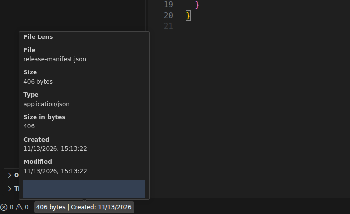
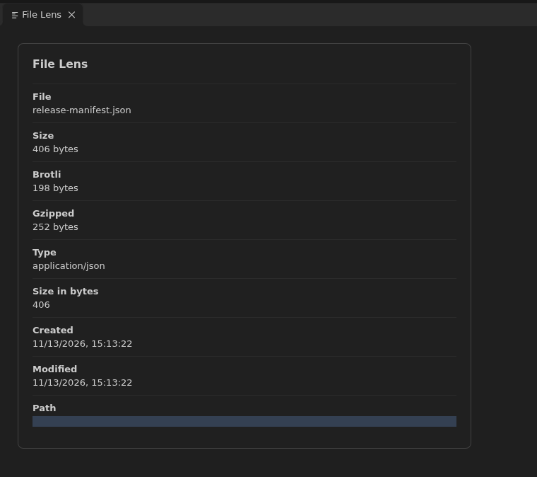
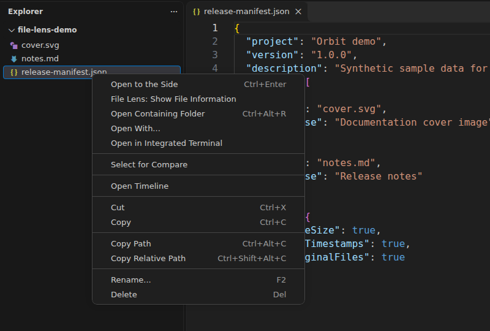

# File Lens

**File facts, one hover away.**

Check a file's size, type, creation time, modification time and path without leaving VS Code. Hover the status bar for a quick look, or open a dedicated read-only details view from Explorer.

[Install from the Visual Studio Marketplace](https://marketplace.visualstudio.com/items?itemName=ken-jo.file-lens) · Extension ID: `ken-jo.file-lens`

## See it in action

### Hover for the essentials

Open a file and hover over its size in the status bar. File Lens brings the file name, readable size, type, timestamps and path together in one tooltip. The creation date can also appear beside the size.



### Open the full details

Run **File Lens: Show File Information** from the Command Palette, or choose it from a file's Explorer context menu. The read-only view gives you more room to inspect the metadata and select text to copy. Optional raw-byte, gzip and Brotli sizes are shown when enabled and available.



### Inspect a file from Explorer

Right-click a file and select **File Lens: Show File Information**. This is also the fallback when a preview does not expose its source file to extensions.



*These are cropped real VS Code desktop captures, not interface mockups. They use synthetic demo files and a fresh, unsigned-in profile. Path values are intentionally masked.*

## Get started

Requires **VS Code 1.64 or newer**.

1. Install **File Lens** by **Ken Jo** from VS Code's Extensions view.
2. Open a saved file. Its size appears in the status bar, on the left by default.
3. Hover over the size for quick information. For a larger view, right-click a file in Explorer and choose **File Lens: Show File Information**.

You can also open Quick Open (`Ctrl+P` on Windows/Linux, `Cmd+P` on macOS) and run:

```text
ext install ken-jo.file-lens
```

Already have a `.vsix` package? Use **Extensions: Install from VSIX...** from the Command Palette.

## What you can see

- **Readable file size**, with binary or decimal units.
- **File name, type and path**, where available.
- **Created and modified times**, supplied by the file-system provider.
- **Raw size in bytes** in the details view when enabled.
- **Gzip and Brotli sizes**, calculated in the extension host when enabled.
- **Text, notebook, image and custom-editor files** whose tabs expose a file URI.

## Make it yours

Search for **File Lens** in VS Code Settings, or use `@ext:ken-jo.file-lens` to show only this extension's settings. All setting keys use the `fileLens` prefix.

If you customized settings before 3.3.7, move those values to the corresponding `fileLens.*` keys.

| Setting | Default | What it changes |
| --- | --- | --- |
| `fileLens.showCreatedInStatusBar` | `true` | Show the creation date beside the size, when available. |
| `fileLens.displayInfoOnTheRightSideOfStatusBar` | `false` | Move File Lens to the right side of the status bar. |
| `fileLens.useDecimal` | `false` | Use decimal units instead of binary units. |
| `fileLens.use24HourFormat` | `true` | Use a 24-hour clock instead of a 12-hour clock. |
| `fileLens.showRawInBytes` | `false` | Include the byte count in the details view. |
| `fileLens.showGzip` | `true` | Include gzip size in the details view. |
| `fileLens.showBrotli` | `false` | Include Brotli size in the details view. |
| `fileLens.showGzipInStatusBar` | `false` | Include gzip size in the status bar. |
| `fileLens.showBrotliInStatusBar` | `false` | Include Brotli size in the status bar. |

For example, show both compressed sizes in the details view and move the status item to the right:

```json
{
  "fileLens.displayInfoOnTheRightSideOfStatusBar": true,
  "fileLens.showRawInBytes": true,
  "fileLens.showGzip": true,
  "fileLens.showBrotli": true
}
```

## Privacy and practical limits

- **No account is required.** Metadata is read through VS Code's file-system API. Optional compression reads the file in the extension host; file contents are not sent to an external service.
- **Paths may contain personal information.** Mask them before sharing your own screenshots. The documentation images above already have path values masked.
- Unsaved files do not have on-disk metadata to display.
- Creation dates depend on the file system and can reflect a copy rather than the original creation of the content. Unavailable timestamps are shown as **Unavailable** in details.
- Some webview previews do not expose a source file URI. Use the Explorer context menu or open the source file instead.
- Compression is skipped for files larger than **16 MiB** and can be unavailable if the file cannot be read. Compression sizes describe gzip/Brotli output, not an archive saved to disk.
- Timestamp formatting follows the environment's locale and the 12/24-hour setting; this is not a custom date-format editor.

## Development and screenshots

```sh
npm ci
npm run vscode:prepublish
npm test
```

The **Capture real VS Code screenshots** GitHub Actions workflow builds and installs the actual VSIX in an isolated VS Code desktop under Xvfb. It uses synthetic fixtures, a clean profile and opaque path masks; screenshots are uploaded for review before being added to this README.

## Credits and license

File Lens is an independently maintained fork of [filesize](https://github.com/mkxml/vscode-filesize), originally by Matheus Kautzmann. It can coexist with the original extension.

Distributed under the [MIT license](LICENSE). No affiliation with other similarly named File Lens or FileLens products is implied.
